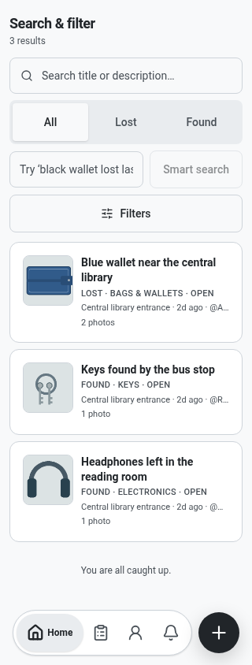
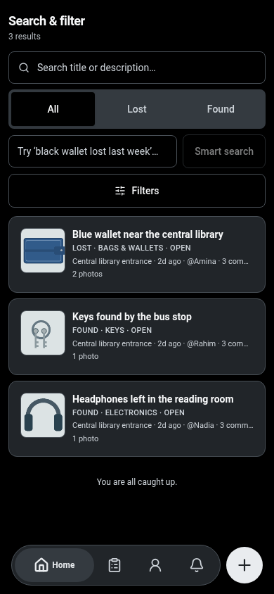

# FindBack

**Status: internal beta (pre-public).** Not a public release; builds are only
installable from a verified GitHub release, and an engineering checkpoint is not
release approval.

Lost something? Found something? Post it, and let people nearby help you get it back to its owner.

FindBack is an Android app for reporting lost and found items. A report works like a normal post: photos, a short description, a date and a spot on the map. Other people can comment, share it, or tell you they've seen the item. The app also suggests lost and found reports that look like each other, so you don't have to scroll through everything.

Web links to shared reports: <https://findbackapp.social>

## Screenshots

Browser captures with synthetic reports, shown in light and true-black themes.
These illustrate the interface, not native-device or real-account acceptance.

  
  

Capture dimensions and checksums: [screenshot manifest](docs/screenshots/manifest.json).

## How it works

1. **Post a report.** Say whether you lost something or found it. Add photos, describe it, pick a date and place.
2. **Look around.** Browse the feed, search with filters, or type a sentence like "black wallet lost near the gate" and let Smart Search turn it into filters.
3. **Check possible matches.** Open one of your reports to see lost and found reports that look similar.
4. **Get in touch and recover it.** Comment on the report, share it, and when the item is back with its owner, mark the report as recovered. You can rate the person who helped.

## What's in the app

- Lost and found reports with photos, rich-text descriptions and map locations
- Feed and search, with several feed layouts to choose from
- Smart Search for plain-language queries
- Possible Matches between lost and found reports
- Comments with replies, mentions, photos, GIFs and links to other reports
- Likes, saved reports, sharing by link
- Notifications, including push
- Profiles with verification badges, successful returns and a reputation level
- Ratings that come from a real recovery, not from random profile visits
- Block, report and feedback tools
- Private messages between users, with message requests and still-image sharing after connection
- Sign in with email or Google; phone verification is not enabled
- Optional AI Chat using your own API key from the provider you choose

This is an internal beta under validation, not a public-ready release. Screens may move as the app grows.

## Your privacy

The full text is in the app under Settings: Privacy Policy, Terms and Community Guidelines. Short version of how the app is built:

- **Email and phone stay private.** Other users see your public profile (name, username, avatar, verification badges). They never see your email address or phone number.
- **Reports are visible to FindBack users.** Photos, descriptions, comments and locations you post can be seen by signed-in users. Shared report links ask the viewer to sign in. Don't post anything you wouldn't want a stranger to read, and blur addresses, papers, faces and serial numbers before adding a photo. The app reminds you of this while you write.
- **You choose how exact a location is.** You can pin an exact spot or an approximate one.
- **Smart Search and match suggestions run on your phone.** What you type into Smart Search is not sent to a cloud model.
- **AI Chat is separate and uses your own key.** Your key stays on your device. Messages you send in AI Chat go to the provider you picked, under that provider's terms, and charges depend on your account with them. FindBack does not run a server that relays them. Chat history is kept only while the app is open and is gone when you close it.
- **Private messages are separate from AI Chat.** Accepted history is stored on each device, with temporary server delivery and private image storage. Messages are not end-to-end encrypted. Push notifications wake the app rather than carrying message text. There is no consumer Drive backup option in this beta.
- **You can delete your account** from Settings. That removes your account, reports and photos. Limited safety records are retained: reported-content evidence for up to 90 days, and appeal, moderation and audit records after deletion. Deletion cannot remove another person's existing copies of messages or files.
- **Staff tools are locked down.** Moderators and admins use the same app as everyone else. Their tools only appear for accounts that have been given a role, and the backend checks the role on every privileged action. Hiding a button is never the only protection.

## Safety

Meeting a stranger to hand over an item has real risks. Verify ownership before you hand something over: ask the owner for one detail that isn't in the post. If you find an ID or a card, keep one identifying detail out of the report so the real owner can prove it's theirs. Use the Report button on anything that looks like a scam, spam, harassment or stolen property.

## Install

Android is the primary target. Only builds explicitly verified and published on the GitHub Releases page should be installed; an internal engineering checkpoint is not release approval.

## Project status

FindBack is a working internal beta. The consumer flows are implemented and covered by
automated checks, but real two-account, multi-device, staff-session and phone-photo
acceptance is still outstanding. See [ROADMAP.md](ROADMAP.md) for direction and
[docs/history/](docs/history/) for how the version line is derived.

## For developers

- Setup, stack, layout and checks: [docs/DEVELOPMENT.md](docs/DEVELOPMENT.md)
- Architecture and data flow: [docs/ARCHITECTURE.md](docs/ARCHITECTURE.md)
- Data model: [docs/erd/](docs/erd/)
- Version history: [docs/history/VERSION_HISTORY.md](docs/history/VERSION_HISTORY.md)
- Freeze record: [docs/releases/BETA_FUNCTIONAL_FREEZE_2026-10-30.md](docs/releases/BETA_FUNCTIONAL_FREEZE_2026-10-30.md)
- Course-era material (provenance only): [docs/course/](docs/course/)

## Contributing

See [CONTRIBUTING.md](CONTRIBUTING.md). Security problems go to
[SECURITY.md](SECURITY.md), never a public issue.

## License

FindBack is **source-available, not OSI open source**. It is licensed under the
[PolyForm Noncommercial License 1.0.0](LICENSE.md); commercial use needs a separate
written license ([COMMERCIAL.md](COMMERCIAL.md)). The FindBack name and branding are
reserved ([BRANDING.md](BRANDING.md)); third-party components keep their own licenses
([THIRD-PARTY-NOTICES.md](THIRD-PARTY-NOTICES.md)).

## Project origin

FindBack started in 2026 as a university course project and grew into a real
lost-and-found product. Course-era requirements, plans and evaluation material are
kept under [docs/course/](docs/course/) for provenance; they are not the current
product specification and they are not acceptance evidence.
